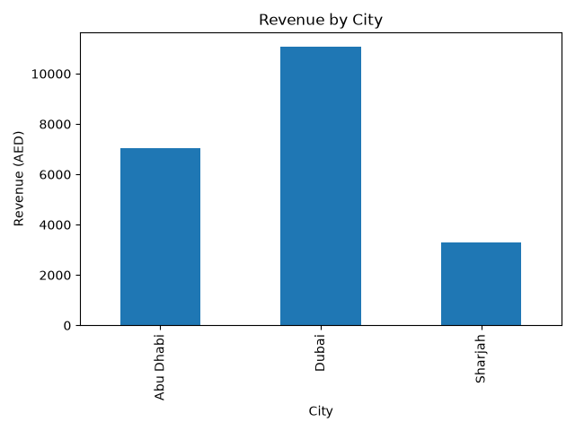
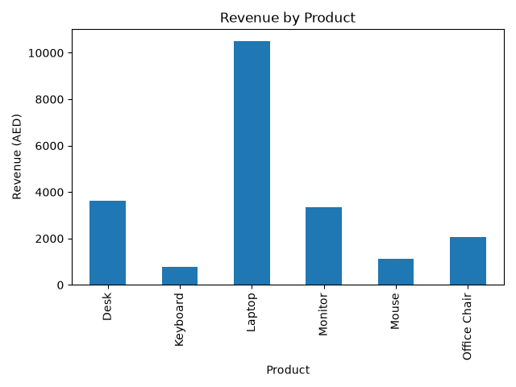
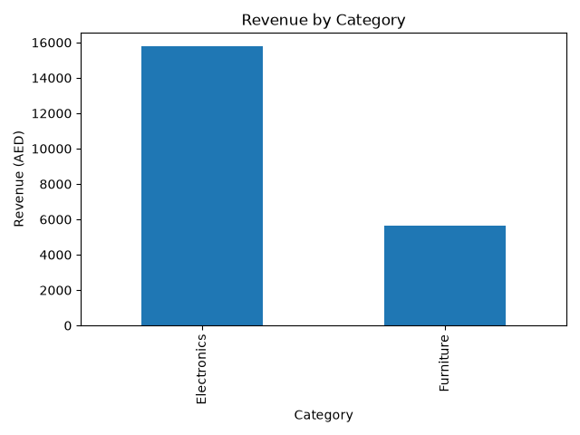
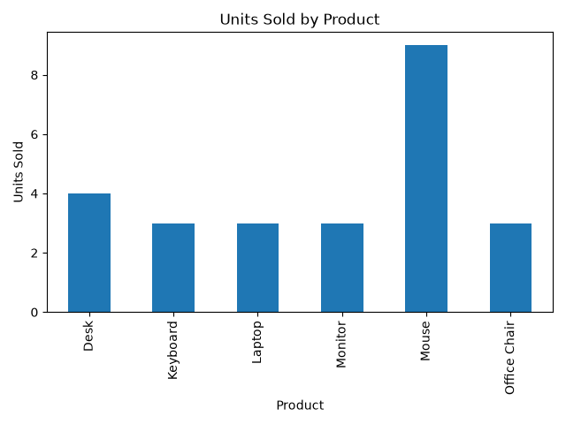
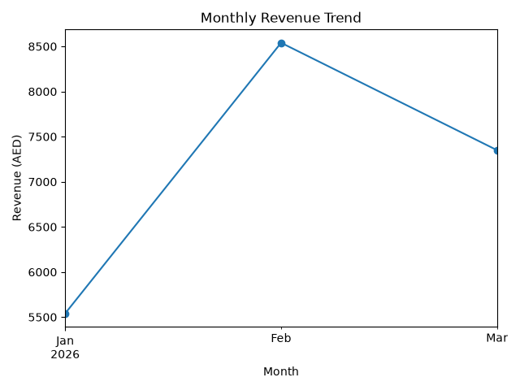

# Python Sales Analysis Project

## Overview

This project analyzes a small sales dataset using Python and Pandas.

The goal is to answer business questions such as:

- What is the total revenue?
- Which product generates the most revenue?
- Which product sells the most units?
- Which city performs best?
- Which category generates the most revenue?
- How does revenue change over time?

## Technologies Used

- Python
- Pandas
- Matplotlib

## Project Structure

```text
python-sales-analysis/
│
├── data/
│   └── sales.csv
│
├── images/
│   ├── revenue_by_city.png
│   ├── revenue_by_product.png
│   ├── revenue_by_category.png
│   ├── units_sold_by_product.png
│   └── monthly_revenue_trend.png
│
├── analysis.py
├── visualization.py
└── README.md
## Analysis Performed

The project calculates:

- Total revenue
- Total units sold
- Average order value
- Revenue by product
- Revenue by city
- Revenue by category
- Units sold by product
- Monthly revenue trends

## Key Findings

Based on the dataset:

- Total revenue: AED 21,430
- Dubai generated the highest revenue
- Laptop generated the highest product revenue
- Electronics was the strongest revenue category
- Monthly revenue trends were analyzed across January, February, and March

## Visualizations

### Revenue by City



### Revenue by Product



### Revenue by Category



### Units Sold by Product



### Monthly Revenue Trend



## How to Run the Project

Install the required libraries:

```bash
pip install pandas matplotlib

Run the analysis:
python analysis.py

Generate the charts:
python visualization.py


What I Learned
Through this project, I practiced:
- Loading CSV datasets with Pandas
- Exploring and understanding datasets
- Creating calculated columns
- Grouping and aggregating data
- Working with dates
- Calculating business metrics
- Creating data visualizations with Matplotlib
- Organizing a Python project into multiple files